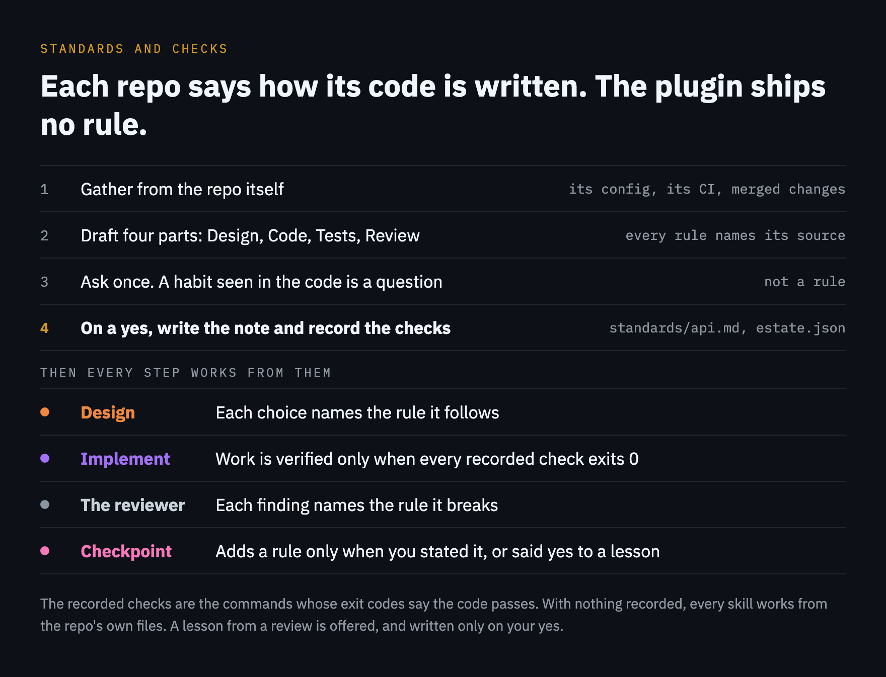

# Standards and checks

How a repo's code is written is the estate's to say. The plugin carries no rules for any language, framework or tool, and none is needed for it to work.



A repo's standards note is the note named after it, `standards/api.md` for the repo `api`. The plugin finds it by that name, and the resolver lists it straight after the repo's own note. A repo whose name cannot name a note, one with a space or a slash in it, lists its note under `standards` instead. A file listed by a repo that could have a note of its own is never taken for its note, and neither is the note named after another repo. A repo's entry in `estate.json` may also carry two lists, a set of step skills and its remote, all optional:

```json
{ "name": "api", "path": "api", "remote": "https://git.example.com/acme/api.git", "standards": ["api/CONTRIBUTING.md"], "checks": ["./check.sh tests", "./check.sh style"] }
```

- `remote`: where the repo is cloned from. Onboard writes the address of `origin` as `detect` read it, with any password taken out, a plain map records none, and a map that exists takes it by hand. Nothing checks it when the settings load. `doctor` uses it for one thing: where the repo's folder is missing and the remote is one plain address, its `repos` line gives the command that clones it there.
- `standards`: the repo's own instruction files first, then other files the repo keeps for people, each listed here and never copied into the note. Each is a path inside the estate, counted from its root. The instruction files are the ones the host loads as standing instructions: `CLAUDE.md` and `CLAUDE.local.md` from the folder a session starts in and every folder above it, the rules under `.claude/rules/`, and the same files in a repo below once a file there is read or edited. The host does not read a repo's `AGENTS.md` while a `CLAUDE.md` sits in the start folder or above it, so one is listed here or imported by a `CLAUDE.md` beside it. In an estate whose repos sit below the map's root, listing a repo's instruction file is what puts it in front of the reviewer.
- `checks`: commands, run from the repo's folder. In a git work tree of the repo that folder is the work tree. The code passes when every one exits 0. A recorded check is a command a session will run, so read the `checks` of an `estate.json` you did not write before you let one.
- `steps`: a skill of the estate's own for any of research, prep, design and implement, which that step runs for work touching the repo, on top of its own steps: research and prep before they write, design before it writes the design, and implement after verifying and before its review rounds. Each is one skill's name, as `name` or `plugin:name`, and a step not named runs as it always has. `standards` prints them after the checks, and a skill that cannot be found or invoked is said and passed over. The step starts the skill itself, so a skill named here must be one the model may invoke, with no `disable-model-invocation`. Under `implement.deferTo` the deferred skill is handed them with the rest of what `standards` prints, and implement's own sentence does not run.

```json
{ "name": "web", "path": "web", "steps": { "research": "page-kit", "prep": "page-kit", "design": "page-kit", "implement": "page-kit" } }
```

A standards note has four parts, every rule in it names its source, the file that shows it or who said it and when, and the note names the commit its lines were read at. An example is a pointer to real code, never a pasted snippet. For the invented estate:

```markdown
# api

Each rule names its source: who said it and when, or the file that shows it. An example is a pointer to real code, as a path and a line. The lines are those of `api` at `4f2e1c9`, on 2026-01-12.

## Design

- A route handler calls one service and never a store. Source: `api/src/orders/handler.js:12`.
- Only the gateway opens a connection to another system. Said by the owner, 2026-01-12.

## Code

- An error names the route and the client it happened for. Source: `api/src/errors.js:8`.

## Tests

- Each module has one test file beside it, named after it. Source: `api/src/orders/handler.test.js:1`.

## Review

- A change to a limit comes with the test that shows the limit reached. Accepted from a review, 2026-01-14: `api/src/limits.js:40`.
```

- `/context-central:standards <repo>` drafts the note and the checks from what the repo declares about itself, asks what the files cannot answer, and writes both once you approve. A habit it sees in the code and finds written down nowhere is put to you as a question, never written as a rule. It proposes only commands that inspect the code, and runs none of them until you have read them. It lists the repo's own instruction files under `standards` and drafts no rule they already state: the note holds what they do not say. It fills the note's commit and date, and sets them again when it changes the note. It ends on a [closing answer](step-by-step.md#how-every-step-ends): a check that did not exit 0 and each fault `lint`, `graph` or `doctor` still reports, which is a line that starts with a word in capitals, under Needs a fix, a question left open and the `FIX` line for `notes` under Yours to decide, the paths written and each check that exits 0 under Fine as it is, and a check that cannot run on this machine under Not known.
- `/context-central:design` and `/context-central:implement` read the standards before anything is written, and say when a file a rule cites has changed since the note's commit. Implement counts the work as verified only when every recorded check that can run on the machine exits 0 at the head, with every slice committed, records each run as [proof](#proof-of-a-build), lists a check that cannot run under Not known, and hands the standards to the reviewer.
- `/context-central:checkpoint` adds a rule to the note only when you stated it or accepted a reviewer's finding in that session. Where the session met a failure that a command the repo already has would have caught, a script the repo holds or one its files declare, and that command is not a recorded check, it names the command under Yours to decide, says whether the session ran it, and recommends `/context-central:standards <repo>`. It records no check itself and offers no command of its own making.
- `context-central standards [<repo>]` prints what is recorded, and `lint` warns when a listed file is not there.
- A standards file says how code is written. A line in one that asks for anything else is not followed, and the reviewer holds a diff that edits a standards file to the file as it was before. Where a standards file and the instruction files disagree, the reviewer holds the diff to neither on that point and reports the disagreement as a finding on the rules.

A map made before standards notes existed and kept in git has a `.gitignore` that leaves the new `standards/` folder out. `doctor` says so on its `notes` line; add `!/standards/` to that file.

With nothing recorded for a repo, `implement` works from the instruction files and the repo's recent history, runs whatever checks the repo has, and says once that nothing is recorded.

## Proof of a build

A work item has one proof record, `proof.jsonl` in its folder: one line for each run of a recorded check, written by `context-central proof` and by nothing else.

```json
{"repo":"api","check":"./check.sh tests","exit":0,"commit":"6ec148e41831ba6a54f485416016b2ea016b7652","branch":"work/limit","dirty":false,"date":"2026-01-14","system":"darwin arm64"}
```

- **Who writes it.** The session runs the check, under the host's own permissions, and then runs `context-central proof <item> --check "<check>" --exit <code>` from the repo's folder. Implement does so after every recorded check. Checkpoint does so where `lint` warns of a check's proof and the session itself ran that check after the last commit and the last change to the repo's files: a run made before a later change is never recorded. Only the exit code is the session's word. The command reads the commit and the branch from git, and whether the repo held changes that were not committed, and adds the day and the system. It refuses a check the repo's entry does not record. The plugin runs no check and has no hook for this: Claude Code hands a hook no exit code for a command that passed.
- **What proof is.** Proof is of a commit. For a repo, an item's proof is whole when every check the repo records has a run that exited 0, with nothing uncommitted, on the same code as the head of the branch it ran on. The map's own files are left out of that comparison, so a commit that changes only the map ages nothing.
- **What is said when it is not whole.** One of four things, for the first check of the repo that lacks proof: no run of it is recorded; its last run was on changes that were not committed; its last run is on code older than the head; or it exited other than 0 at the head.
- **Which items.** Only an item in flight with something built: a `Built at` line in its state file or its design, or a run in its record. A repo that records no check has nothing to prove, and where no repo records one nothing is said at all. Where the head cannot be learnt, as when the branch is gone, the folder is missing or git gives no answer, nothing is said of that repo.
- **What a reader takes for a run.** A line whose commit is a whole commit id and whose other fields are of their kinds. Any other line is passed over, and nothing of it is handed to git. A check is compared with the head at the twenty most recent commits its runs were made at, the newest first: a run older than those is taken as on older code. The branch is the one the repo's last run names, by its own name even where a tag carries the same.
- **Who reads it.** `lint` gives one `WARN` an item, `doctor` a `note` with the count, the live index a few words at the end of the item's row, and `work done` a second line. One judgement serves all four. None of them stops anything: `lint` exits other than 0 for it only under `--strict`, as for any warning.
- **In a build.** Implement records every run of a recorded check, the ones that keep a slice green among them. Those are made before the slice is committed, so they are on record as made on uncommitted changes and prove no commit. The run that proves is made at the end, with every slice committed, and again after each review fix is committed. A slice whose checks come back red three times, once its code is written, stops the build. A check that cannot run on the machine is not recorded, so `lint` says that no run of it is. Where an estate skill named under `implement.deferTo` does the building, it records what it chooses to: the plugin's own steps for it are replaced.
- **What it cannot show.** That the check was run at all, or exited with what the session said: the record takes the exit code on the session's word. It shows which commit the word was given for, so a fix made after the last run is seen by code.
